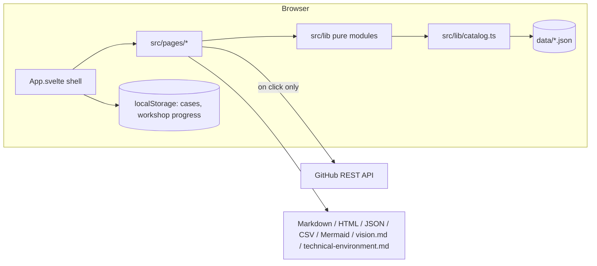

# Architecture

## Modules

| Module | Purpose | Tested by |
|---|---|---|
| `lib/catalog.ts` | Loads the JSON catalogs for the browser build | — |
| `lib/aidlc.ts` | Profile → stages, skipped stages, agent roles per stage, plan vs profile, stage guide Markdown | `tests/aidlc.test.mjs` |
| `lib/frameworks.ts` | Framework ID lookup (NIST AI RMF, OWASP LLM/ASI 2026, ATLAS), threat register sync | `tests/frameworks.test.mjs` |
| `lib/simulation.ts` | Monte Carlo graph walk for cost and latency | `tests/simulation.test.mjs` |
| `lib/slo.ts` | Error budget, latency check | `tests/simulation.test.mjs` |
| `lib/workshop.ts` | Checkpoint questions built from catalogs, progress | `tests/workshop.test.mjs` |
| `lib/references.ts` | Reference filter, citation index, integrity rules, `references.md` | `tests/references.test.mjs` |
| `lib/validate.ts` | Ajv validation of imported cases | `tests/schemas.test.mjs` |
| `lib/model.ts` | Case factory, profile stage plan, `migrateCase` | e2e |
| `lib/financial.ts`, `lib/planning.ts` | Average-based projection; Unit dependency waves | `tests/financial.test.mjs`, `tests/planning.test.mjs` |
| `lib/reports.ts`, `lib/vision.ts` | Report, vision.md and technical-environment.md generation | e2e |
| `lib/state.ts` | Current page (URL hash, back trail), cross-page focus, notices, sample requests | e2e |
| `lib/exportmap.ts` | Studio input → package file, section and use (TRACEABILITY.md, In-the-export bars) | `tests/exportmap.test.mjs` |
| `lib/crosslinks.ts` | Stage → pages and control → page mapping for links (studio mapping) | e2e |
| `lib/guidance.ts` | Next-action checks and page significance (text from stage and framework catalogs) | `tests/kit.test.mjs` |
| `lib/workspace.ts` | Workspace package: kit + AI-DLC team templates + stage-gate and Trusted AI documents | `tests/workspace.test.mjs` |
| `lib/kit.ts`, `lib/zip.ts` | Implementation kit (CLAUDE.md, AGENTS.md, skills, subagents, MCP) and zip writer | `tests/kit.test.mjs` |

## Data

| File | Content | Source |
|---|---|---|
| `aidlc-stages.json` | 33 stages, phases, rules, rule file, `produces` list and record folder per stage | AI-DLC v2.11.5 guide 04 and 14; stage rule files |
| `aidlc-artifact-templates.json` | 24 team templates (artifact, stage, record path, section headings, quoted rule text) | AI-DLC v2.11.5 stage rule files; location from stage-protocol.md "Template overrides" |
| `aidlc-profiles.json` | 11 profiles, depth and test levels | AI-DLC v2.11.5 workflow-profiles and 05 |
| `aidlc-agents.json` | 14 agents | AI-DLC v2.11.5 guide 06 |
| `frameworks/nist-ai-rmf-1.0-subcategories.json` | 72 subcategories with text | NIST AI 100-1 PDF |
| `frameworks/owasp-llm-2026.json`, `owasp-asi-2026.json` | 10 items each | genai.owasp.org |
| `frameworks/atlas-techniques.json` | Techniques used by the app | ATLAS 2026.10 data file |
| `frameworks/threat-candidates.json` | Threats listed per node kind | Studio mapping |
| `trust-controls.json` | 35 controls with `referenceIds`, `frameworkIds` and `aidlcGatePhase` | Project controls; IDs and gate phase are studio mappings |
| `workshop/modules.json` | Modules 0–8 | Upstream facilitator, workshop-mode and onboarding guides; project training-tracks deck |
| `aidlc-gates.json` | 13 gate types (11 AI-DLC, 2 studio) | AI-DLC v2.11.5 guide and rule files |
| `references.json` | 61 references | Checked 2026-11-25 |
| `samples/*.json` | Two fictional demo cases | Generated by `scripts/gen-samples.mjs`; invented example values |
| `pattern-catalog.json` | 25 agent patterns, 40 RAG techniques | Project master reference |
| `schemas/*.json` | Case and reference schemas | — |

## Case schema changes (migration)

`schemaVersion` stays 1. Added fields: node `identity`, `inputTokens`, `outputTokens`, `inputPricePerM`, `outputPricePerM`, `cachedInputPct`, `cachedInputPricePerM`, `costPerCallUsd`, `latencySeconds`, `routing`; edge `probability`; case `threats`. All are optional in the schema and filled with defaults by `migrateCase()` when a saved or imported case is opened. Stage plans no longer pre-fill an owner.

## Boundaries

No backend, no authentication, no model calls, no AI-DLC execution. Graph edges are planning entities, not live MCP or A2A connections.
