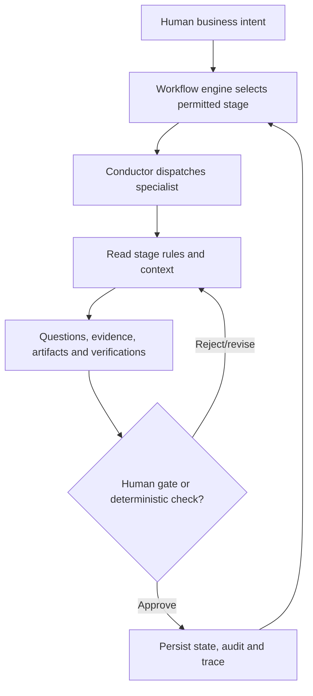

# AWS AI-DLC field guide — operational and technical walkthrough

**Basis:** AWS Labs [`awslabs/aidlc-workflows`](https://github.com/awslabs/aidlc-workflows), current public docs reviewed on November 25, 2026. This guide describes a methodology and planning adaptations; it does not substitute for the released workflow engine or its stage-rule files. Version pinning is necessary because upstream evolves.

## Fundamental model

AI-DLC is a **governed AI-executed software engineering lifecycle**, not merely an AI code-completion tool. Humans specify intent, decide scope, evaluate technical choices and authorize consequential transitions. A deterministic workflow engine selects stages and records state; a conductor delegates bounded work to specialized agents; artifacts preserve context and approvals. The framework applies different depths according to work type rather than running a fixed waterfall for all tasks.

Five phases in the currently documented workflow implementation: **Initialization (3 stages), Ideation (7), Inception (9), Construction (7), Operation (7) = 33 stages.** The earlier conceptual shorthand Inception → Construction → Operations does not capture the full current implementation.

## Phase 0 — Initialization

Stages: **0.1 Workspace Scaffold**, **0.2 Workspace Detection**, **0.3 State Initialization**.

Objectives: establish the intent record and shared workspace, identify brownfield/greenfield context, choose an approved stage plan and persist workflow state. Enterprise controls to add: product ownership, risk tier, repository inventory, workload class, model/connector allowlists, approval identities and data residency.

**Pitfall:** project detection can miss a monorepo or unusual deployment layout. Do not equate a source scan with actual runtime inventory.

## Phase 1 — Ideation

1. Intent Capture & Framing → product statement and stakeholders.
2. Market Research → build/buy and market context where applicable.
3. Feasibility & Constraints → viability, RAID, technology/policy constraints.
4. Scope Definition → explicit in/out scope and bounded backlog.
5. Team Formation → human and AI responsibilities.
6. Rough Mockups → concepts and user-flow hypotheses.
7. Approval & Handoff → authorized initiative brief and decision.

The gate answers: **are we solving a worthwhile and feasible problem, and who approves the scope?** Requirements invented by an AI agent must remain *proposed* until corroborated.

## Phase 2 — Inception

1. Reverse Engineering — evaluate existing code, architecture, interfaces and repo dependencies.
2. Practices Discovery — capture team conventions and project guardrails.
3. Requirements Analysis — write verifiable functional and quality requirements.
4. User Stories — actor journeys and acceptance criteria.
5. Refined Mockups — detailed interaction design where needed.
6. Domain Design — components, domain entities, architecture and ADRs.
7. Units Generation — dependency-aware Units of Work and story traceability.
8. Contract Design — APIs, integration schemas and boundary guarantees.
9. Delivery Planning — Bolt / sequencing rationale, Unit order and approvals.

**Units are not merely backlog cards**. They should be independently testable engineering slices with explicit inter-Unit dependencies. Parallelizable Units must have stable interfaces, guarded data migrations, owners and integration controls. A plan must distinguish dependency graph from a human release or Bolt plan.

The gate answers: **is the design sufficiently coherent, safe and executable to begin implementation?** For brownfield applications, verify discovered architecture against production telemetry and deployment inventory.

## Phase 3 — Construction

Per applicable Unit: **3.1 Functional Design**, **3.2 NFR Requirements**, **3.3 NFR Design**, **3.4 Infrastructure Design**, **3.5 Code Generation**. Solution-level: **3.6 Build and Test**, **3.7 CI Pipeline**.

In Construction, the development agent prepares a code-generation plan tied to requirements and tests. A human review/approval may be required before implementing. Testing posture may be TDD, BDD, acceptance-test-driven, test-after or a team-specific contract. The "working skeleton" approach verifies a small integrated slice before expanding into more Units.

**Critical caveat:** AI-written code and AI-written tests can agree on the same wrong premise. Use independent acceptance suites, contract validation, adversarial security testing and human architectural review.

Parallel swarm execution, where configured, is conditional on dependency and approval requirements. Never assume two Units can run in parallel because they have different names: shared files, schemas and stateful tools can create interference.

## Phase 4 — Operation

Stages: **4.1 Deployment Pipeline**, **4.2 Environment Provisioning**, **4.3 Deployment Execution**, **4.4 Observability Setup**, **4.5 Incident Response**, **4.6 Performance Validation**, **4.7 Feedback & Optimization**.

The runtime must have SLOs, verified deployment/rollback, incident ownership, operational tests, cost monitoring and a feedback loop into design. This phase concerns the **delivered software**; the AI agent platform itself also needs separate Managed AI Operations controls (agent identity, model availability, prompt/memory governance, model/token spending, trace audit, policy controls).

The gate answers: **can the service be safely deployed, recovered, monitored and continually improved?** AI agents should not directly bypass enterprise change-authorization processes.

## Execution control loop

**Enterprise principle:** the model can propose work; it cannot legitimately declare policy approval or production authorization by itself. Keep strong identity, permission enforcement and evidence verification outside model prompts.

## Reference AWS agents

Representative AWS personas: product, architect, developer, quality, design, delivery, compliance, DevSecOps, AWS platform, pipeline/deploy and operations; reviewer personas and a workflow composer exist as well. They are roles in workflow execution, not inherently eleven distinct always-on microservices. The repository's `AGENTS.md` and documentation identify the exact current set.

## Common failure modes

| Failure | Why it appears | Response |
|---|---|---|
| Source context contamination | Outdated or malicious repository guidance | Versioned sources, authorization, provenance and human review |
| Requirements laundering | Model guesses become approved-looking text | Source attribution, explicit question list and sign-off |
| Excessive Unit fragmentation | Unnecessary repeated context and integration cost | Decompose by independent testability and stable boundaries |
| False quality confidence | Generator and evaluator share incorrect assumptions | Independent tests and external acceptance evidence |
| Cost or tool amplification | Cyclic agents, broad tool permissions, unbounded retries | Step/time/token ceilings, policy gates and kill switches |
| Approval fatigue | Too many low-signal gates | Risk-tiered approval policy and independent evidence |
| Production governance bypass | Code generation incorrectly conflated with deployment approval | External privileged release controls and audit trail |

## Large-enterprise implementation approach

- **Platform team:** secure harness configuration, runtime/model allowlist, project bootstrap, identity, repository integrations and agent operating costs.
- **Engineering practice office:** govern workflow profiles, Unit decomposition, specification/quality conventions and role-based training.
- **Trusted AI:** risk classification, independent controls, evidence verification, threat modeling and audit readiness.
- **Managed AI Ops:** telemetry, incident response, drift, reliability, capacity and cost of the agent platform itself.

Pilot one complex brownfield change and a smaller feature change. Compare measured engineering flow (lead time, rework, escapes, change failure, cost per comparable change) rather than lines of AI-generated code. Pin the upstream version, track artifacts from requirement to release, and hold explicit go/no-go decisions before broad adoption.

## References

- https://github.com/awslabs/aidlc-workflows
- https://github.com/awslabs/aidlc-workflows/blob/main/docs/guide/04-phases-and-stages.md
- https://github.com/awslabs/aidlc-workflows/blob/main/docs/guide/16-worked-examples.md
- https://github.com/aws-samples/sample-collaborative-ai-dlc/blob/main/docs/getting-started/methodology.md
