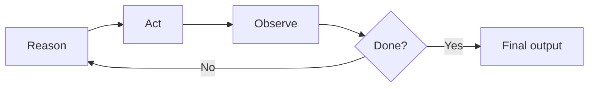
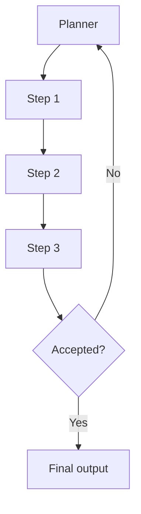
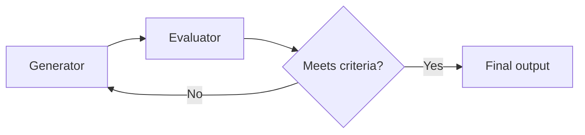
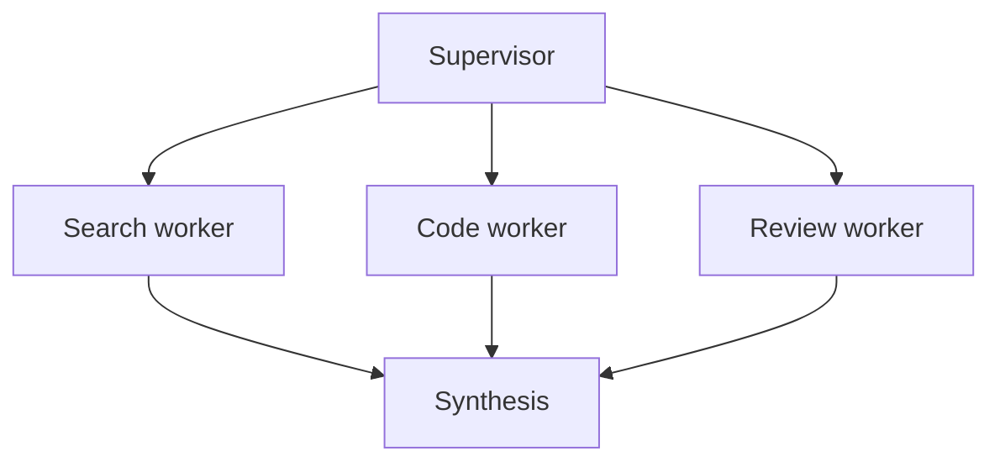
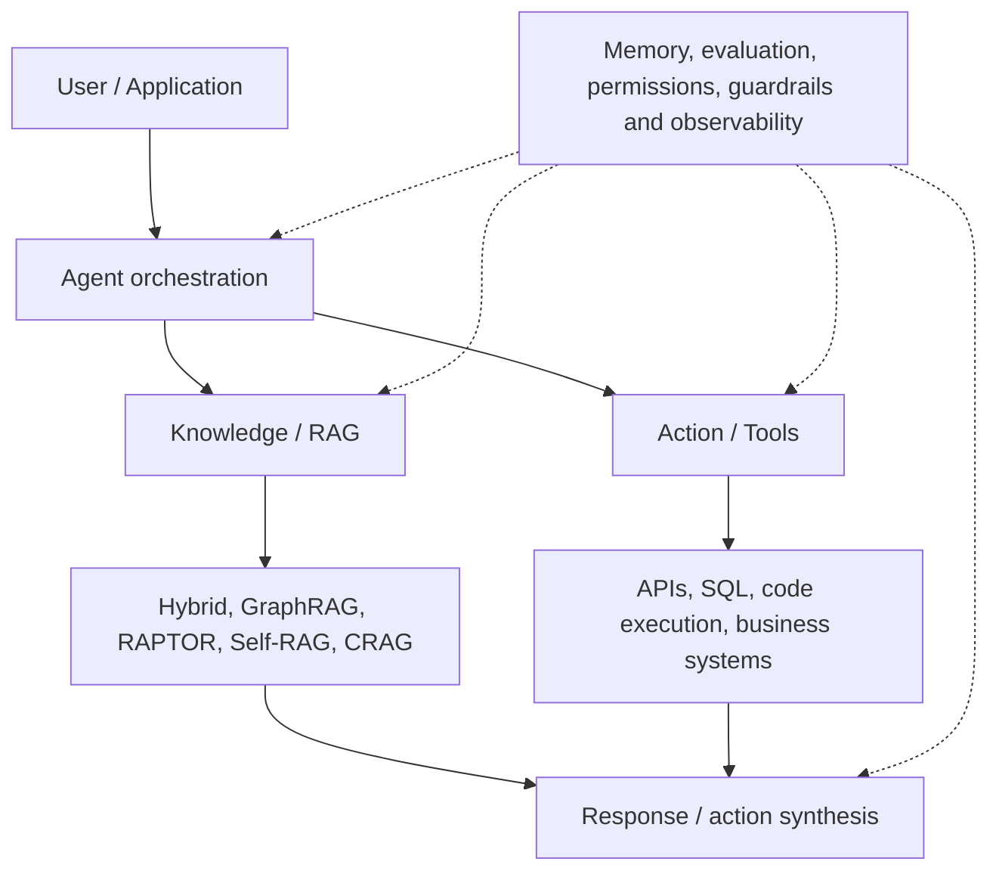
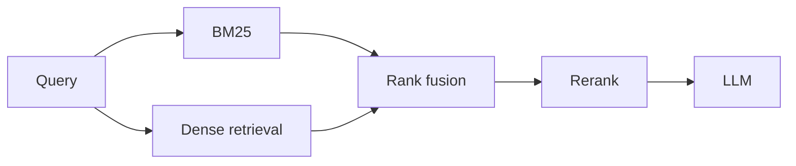
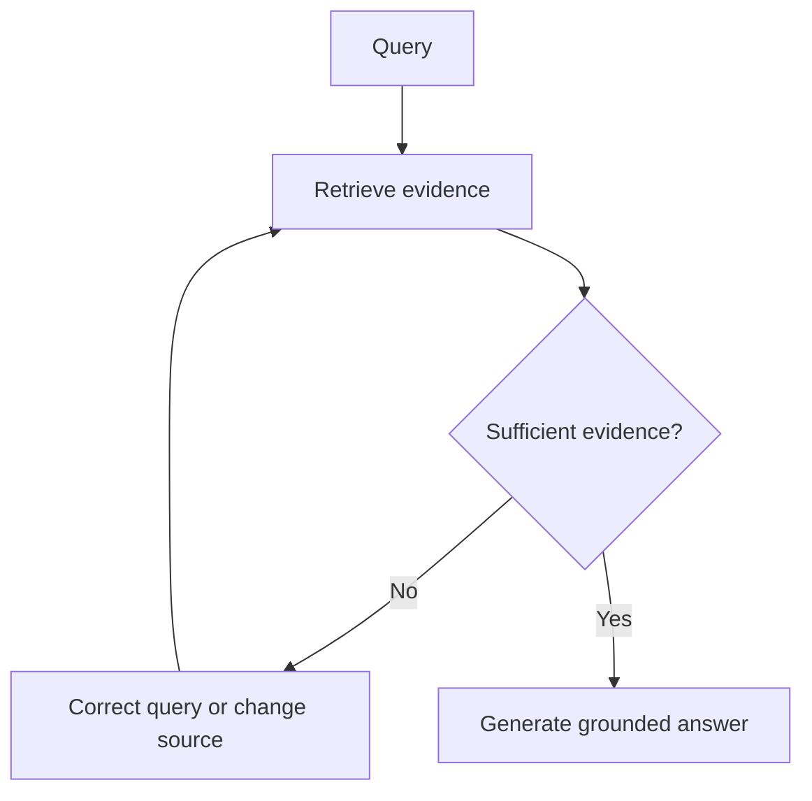

# RAG Techniques and AI Agent Design Patterns

## Master reference for Generative AI and Agentic AI architects

**Research snapshot:** November 25, 2026 (as reported in the preceding discussion).

This document consolidates the original top 10 RAG techniques, expanded 40-technique taxonomy, revised top 20 learning shortlist, 15 agent patterns, architecture guidance, research references, GitHub repositories and production competencies.

**Scope and limitations:** Rankings are curated learning priorities, not benchmark leaderboards. Techniques overlap and can be combined. Recent papers may be experimental preprints. Research links and reported benchmark figures are carried forward from the preceding discussion, not independently reverified during this export. Repositories have not been executed and benchmark results have not been reproduced.

## Table of contents

1. [RAG versus agents](#1-rag-versus-agents)
2. [Original top 10 RAG techniques](#2-original-top-10-rag-techniques)
3. [Expanded 40-technique RAG taxonomy](#3-expanded-40-technique-rag-taxonomy)
4. [Revised top 20 RAG learning shortlist](#4-revised-top-20-rag-learning-shortlist)
5. [Research landscape and recent developments](#5-research-landscape-and-recent-developments)
6. [Top 15 AI agent patterns](#6-top-15-ai-agent-patterns)
7. [Combined enterprise architecture](#7-combined-enterprise-architecture)
8. [Enterprise use cases](#8-enterprise-use-cases)
9. [Production RAG competencies](#9-production-rag-competencies)
10. [Learning roadmap](#10-learning-roadmap)
11. [Research papers and references](#11-research-papers-and-references)
12. [GitHub repositories](#12-github-repositories)
13. [Final recommendations](#13-final-recommendations)

---

## 1. RAG versus agents

Retrieval-Augmented Generation (RAG) provides external evidence to a generative model. Agent patterns govern how a model plans, reasons, uses tools, evaluates results and completes tasks.

| Capability | RAG | Agent |
|---|---|---|
| External knowledge | Yes | Via tools or RAG |
| Autonomous decisions | Limited in traditional RAG | Possible |
| Task planning | Not typically | Yes |
| API execution | Not typically | Yes |
| Iterative reasoning | Advanced RAG | Yes |
| Multi-agent collaboration | Possible through agentic RAG | Yes |
| Primary objective | Knowledge-grounded answers | Goal completion |

Predefined LLM workflows and autonomous agents are related but distinct: workflows follow predetermined control paths, whereas agents dynamically select actions. Some patterns below are workflow or reasoning patterns rather than full agent architectures.

## 2. Original top 10 RAG techniques

| # | Technique | Core mechanism / workflow | Best use case | Complexity |
|---|---|---|---|---|
| 1 | Naive RAG | Query → embedding → vector search → LLM | HR policy and document Q&A | Low |
| 2 | Hybrid RAG | Query → BM25 + dense search → fusion → optional reranking → LLM | Enterprise search, product IDs and legal terminology | Medium |
| 3 | GraphRAG | Extract entities and relationships → graph/community retrieval → synthesis | Fraud, supply chains, connected knowledge | High |
| 4 | Hierarchical RAG / RAPTOR | Recursively cluster and summarize documents → retrieve at multiple levels | Annual reports and technical manuals | High |
| 5 | HyDE | Query → hypothetical document → embedding → retrieve real evidence | Ambiguous technical queries | Medium |
| 6 | Self-RAG | Retrieve as needed → generate → critique evidence and answer | Evidence-grounded assistants | High |
| 7 | Corrective RAG (CRAG) | Retrieve → evaluate relevance → correct or use alternative search | Incomplete or unreliable knowledge bases | High |
| 8 | Adaptive RAG | Classify query complexity → no retrieval, single-step or iterative retrieval | General-purpose copilots | High |
| 9 | Multimodal RAG | Retrieve text, images, tables or other modalities → multimodal generation | Financial statements, scanned PDFs, drawings | High |
| 10 | Agentic RAG | Plan → select sources/tools → retrieve → verify → iterate | Research and enterprise automation | Very high |

Hybrid retrieval can use Reciprocal Rank Fusion (RRF). Original Self-RAG trains a model to decide when to retrieve and critique evidence using reflection tokens. CRAG evaluates retrieved evidence and triggers corrective actions. RAPTOR stands for Recursive Abstractive Processing for Tree-Organized Retrieval. HyDE uses hypothetical text as a search representation, not as factual evidence.

Other notable names: Modular RAG, RAG-Fusion, Contextual RAG, Multi-Hop RAG, Conversational RAG, SQL-RAG, LightRAG, HippoRAG, LazyGraphRAG and FLARE.

## 3. Expanded 40-technique RAG taxonomy

The original ten remain important but omit significant indexing, query optimization, retrieval, context engineering and emerging research families. These 40 learning topics are grouped into eight architectural categories, not mutually exclusive systems.

### A. Foundational RAG

| # | Technique | Mechanism |
|---|---|---|
| 1 | Naive / Dense RAG | Embedding-based vector retrieval |
| 2 | Sparse / Lexical RAG | BM25, TF-IDF or learned sparse retrieval such as SPLADE |
| 3 | Hybrid RAG | Combine dense and sparse retrieval |
| 4 | Modular RAG | Independently configurable retrieval and generation modules |

### B. Indexing and chunking

| # | Technique | Mechanism |
|---|---|---|
| 5 | Semantic Chunking | Split documents at meaningful semantic boundaries |
| 6 | Proposition-based RAG | Index atomic, self-contained factual statements |
| 7 | Parent-Child RAG | Retrieve small chunks and expand to larger parent sections |
| 8 | Contextual Retrieval | Enrich chunks with document-specific context before indexing |
| 9 | Late Chunking | Contextualize document tokens before pooling chunk embeddings |

### C. Query optimization

| # | Technique | Mechanism |
|---|---|---|
| 10 | Query Rewriting | Reformulate user queries for better retrieval |
| 11 | HyDE | Generate hypothetical documents for embedding-based retrieval |
| 12 | Multi-Query RAG / RAG-Fusion | Generate multiple queries and merge retrieval results |
| 13 | Step-Back RAG | Retrieve using a more abstract, generalized question |
| 14 | Query Decomposition | Break complex questions into searchable subquestions |

### D. Advanced retrieval

| # | Technique | Mechanism |
|---|---|---|
| 15 | Reranking RAG | Rescore retrieved documents with cross-encoders or LLMs |
| 16 | Late-Interaction RAG | Token-level multi-vector matching, such as ColBERT |
| 17 | Multi-Hop RAG | Follow sequential chains of evidence |
| 18 | Metadata-Aware / Filtered RAG | Combine semantic retrieval with structured constraints |
| 19 | Federated RAG | Retrieve and consolidate evidence across distributed sources |
| 20 | Iterative RAG | Alternate retrieval and intermediate reasoning |

### E. Knowledge representation and structure

| # | Technique | Mechanism |
|---|---|---|
| 21 | GraphRAG | Entity, relationship and graph-community retrieval |
| 22 | LightRAG | Lightweight graph-based retrieval at different granularities |
| 23 | HippoRAG | Graph-based associative and multi-hop memory retrieval |
| 24 | RAPTOR | Recursive hierarchical summarization and tree retrieval |
| 25 | Structured / SQL-RAG | Retrieve evidence through SQL, JSON or structured-data interfaces |
| 26 | Temporal RAG | Retrieve time-sensitive and historically appropriate knowledge |

### F. Intelligent and autonomous RAG

| # | Technique | Mechanism |
|---|---|---|
| 27 | Self-RAG | Self-reflective retrieval and generation |
| 28 | Corrective RAG (CRAG) | Assess evidence and trigger corrective searches |
| 29 | Adaptive RAG | Select retrieval strategies based on task requirements |
| 30 | Active RAG (FLARE) | Trigger retrieval dynamically during generation |
| 31 | Agentic RAG | Autonomous retrieval planning and tool selection |
| 32 | RL-based RAG | Learn retrieval and reasoning policies through reinforcement learning |

### G. Context optimization and generation

| # | Technique | Mechanism |
|---|---|---|
| 33 | Contextual Compression RAG | Remove irrelevant information from retrieved context |
| 34 | Fusion-in-Decoder (FiD) | Encode passages independently and jointly attend to them during decoding |
| 35 | Grounded / Verifiable RAG | Evidence attribution, citations, verification and abstention |

### H. Specialized and frontier RAG

| # | Technique | Mechanism |
|---|---|---|
| 36 | Multimodal RAG | Retrieve text, images, tables, audio or video |
| 37 | Visual Document RAG | Retrieve document-page or region embeddings using vision models |
| 38 | Conversational RAG | History-aware retrieval and follow-up question resolution |
| 39 | Memory-Augmented RAG | Retrieve from persistent episodic, semantic or working memory |
| 40 | Long-Context Hybrid RAG | Dynamically choose or combine retrieval and long-context inference |

LightRAG and HippoRAG belong to the broader graph-based retrieval family. Multi-query retrieval and RAG-Fusion are related, with the latter specifically emphasizing fusion of rankings. The grouping is a pedagogical taxonomy rather than an exhaustive systematic classification.

## 4. Revised top 20 RAG learning shortlist

Use this checklist to track progress. All ten original techniques are retained; ten additional learning areas broaden coverage.

| # | Technique | Level | Status in original list |
|---|---|---|---|
| 1 | Naive / Dense RAG | Foundation | Existing |
| 2 | Hybrid RAG | Foundation | Existing |
| 3 | Semantic & Hierarchical Chunking | Foundation | Added |
| 4 | Contextual Retrieval | Foundation | Added |
| 5 | Reranking RAG | Foundation | Added |
| 6 | Query Transformation & RAG-Fusion | Advanced | Added |
| 7 | HyDE RAG | Advanced | Existing |
| 8 | Late-Interaction RAG | Advanced | Added |
| 9 | Multi-Hop RAG | Advanced | Added |
| 10 | GraphRAG | Advanced | Existing |
| 11 | Hierarchical RAG / RAPTOR | Advanced | Existing |
| 12 | Structured / SQL-RAG | Advanced | Added |
| 13 | Contextual Compression | Advanced | Added |
| 14 | Multimodal RAG | Advanced | Existing |
| 15 | Self-RAG | Intelligent | Existing |
| 16 | Corrective RAG | Intelligent | Existing |
| 17 | Adaptive RAG | Intelligent | Existing |
| 18 | Agentic RAG | Intelligent | Existing |
| 19 | Memory-Augmented RAG | Frontier | Added |
| 20 | Reinforcement-Learning RAG | Frontier | Added |

## 5. Research landscape and recent developments

### Recent surveys and landscape references

| Research / repository | Reported date | Focus |
|---|---|---|
| [Mapping the RAG Landscape: A Four Axis Taxonomy](https://arxiv.org/abs/2610.01936) | Oct 2026 | Efficiency, robustness, interactivity and reasoning |
| [Which RAG Paradigm Wins at Scale?](https://arxiv.org/abs/2607.26497) | Jul 2026 | Scaling lexical, dense, graph and agentic retrieval |
| [SoK: Agentic RAG](https://arxiv.org/abs/2603.07379) | Mar 2026 | Planning, memory and autonomous retrieval |
| [RAG Papers](https://github.com/mtuann/rag-papers) | Nov 2026 snapshot | Research tracking |
| [Awesome RAG](https://github.com/awesome-llms-labs/awesome-rag) | Sep 2026 snapshot | Full-stack techniques and tools |
| [RAG Cookbook 2026](https://github.com/FareedKhan-dev/rag-cookbook-2026) | 2026 | Implementation recipes |
| [Awesome GraphRAG](https://github.com/DEEP-PolyU/Awesome-GraphRAG) | 2026 snapshot | Graph retrieval research |
| [RAG: Comprehensive Survey](https://arxiv.org/abs/2506.00054) | 2025 | Architecture, retrieval, generation and robustness |

### Emerging research directions

| Paper | Year | Innovation |
|---|---:|---|
| [Late Chunking](https://arxiv.org/abs/2409.04701) | 2024 | Context-aware chunk embeddings |
| [MemoRAG](https://arxiv.org/abs/2409.05591) | 2024 | Memory-assisted knowledge discovery |
| [HippoRAG 2](https://arxiv.org/abs/2502.14802) | 2025 | Associative memory and non-parametric learning |
| [Search-R1](https://arxiv.org/abs/2503.09516) | 2025 | Reinforcement-learning-based search and reasoning |
| [A-RAG](https://arxiv.org/abs/2602.03442) | 2026 | Agent-controlled hierarchical retrieval interfaces |
| [SE-Search](https://arxiv.org/abs/2603.03293) | 2026 | Self-improving search agents using memory and rewards |
| [AgenticRag-R1](https://arxiv.org/abs/2608.29622) | 2026 | Reinforcement learning with stack-based memory |
| [MemLoc](https://arxiv.org/abs/2609.07093) | 2026 | Long-term conversational memory retrieval |
| [ORDER](https://arxiv.org/abs/2609.17012) | 2026 | Query-dependent indexing and retrieval configuration |
| [Adaptive Long-Context Routing](https://arxiv.org/abs/2609.35831) | 2026 | Uncertainty-based routing between RAG and long context |

### Four major directions

1. **Fixed retrieval → autonomous retrieval:** Agents choose what to search, how deeply to search and when evidence is sufficient. Examples: A-RAG, Agentic RAG and ORDER.
2. **Static knowledge bases → persistent memory:** Systems retrieve past interactions, experiences and connected knowledge. Examples: MemoRAG, HippoRAG 2 and MemLoc.
3. **Prompt-engineered retrieval → learned policies:** Reinforcement learning trains search and reasoning decisions. Examples: Search-R1, SE-Search and AgenticRag-R1.
4. **RAG versus long context → RAG with long context:** Systems route between retrieval and direct long-context processing or combine them.

### Advanced RAG is not always better

The preceding discussion reported the following figures from [Which RAG Paradigm Wins at Scale?](https://arxiv.org/abs/2607.26497), for a matched 150-question evaluation at full corpus scale (reported corpus range approximately 1,000–512,000 documents). These figures are retained for reference but have not been independently rechecked in this export.

| Approach | Reported accuracy score |
|---|---:|
| Agent + BM25 | 69.4 |
| Native BM25 | 54.8 |
| Raw file-system agent | 36.9 |

The earlier discussion also reported substantial graph-index construction overhead for some GraphRAG implementations. Treat this as a study-specific observation, not a universal leaderboard.

**Architecture implication:** Start with strong lexical, dense and hybrid baselines. Introduce graph retrieval, autonomous search and other complexity when measured improvements justify cost, latency and maintenance overhead.

## 6. Top 15 AI agent patterns

| # | Pattern | Core mechanism | Best use case | Complexity |
|---|---|---|---|---|
| 1 | ReAct | Reason → Act → Observe → Repeat | Dynamic tool use, troubleshooting, research | Medium |
| 2 | Plan and Execute | Plan → execute steps → optionally replan | Complex projects and multi-step tasks | Medium |
| 3 | Reflection | Generate → critique → refine | Writing, code and answer quality | Medium |
| 4 | Reflexion | Actor → feedback → reflection → memory → retry | Repeated problem-solving | High |
| 5 | ReWOO | Planner → tool worker → solver | Reduce repeated reasoning overhead | High |
| 6 | Tree of Thoughts (ToT) | Branch → evaluate → prune → select | Math, optimization, strategy | High |
| 7 | LATS | Search tree with actions, reasoning and feedback | Difficult autonomous tasks | Very high |
| 8 | LLMCompiler | Dependency graph → parallel tools → join | API orchestration and aggregation | High |
| 9 | Tool Calling | Select function → invoke → use result | CRM, ERP, SQL and APIs | Low |
| 10 | Prompt Chaining | Sequential specialized LLM operations | Structured document workflows | Low |
| 11 | Routing | Classify → dispatch to specialist | Enterprise copilots and support | Medium |
| 12 | Parallelization | Fan out independent tasks → merge | Bulk analysis and ensembles | Medium |
| 13 | Evaluator-Optimizer | Generate → evaluate against criteria → improve | Compliance and code validation | Medium |
| 14 | Supervisor-Worker | Central orchestrator → specialist workers → synthesis | Enterprise automation and research | High |
| 15 | Multi-Agent Collaboration | Agents exchange information, debate or hand off work | Software teams and business operations | Very high |

### Detailed pattern descriptions

**1. ReAct — Reasoning and Acting:** The agent selects its next action, calls a tool, observes the result and repeats until the task is complete. Set explicit stop conditions and tool permissions.

**2. Plan and Execute:** A planner decomposes a goal into steps. Executors perform them and optionally replan after failures or new information.

**3. Reflection:** The model critiques and improves its own output, usually within the current task. Iteration should stop at an acceptance criterion or budget.

**4. Reflexion:** Stores verbal feedback and reflections from prior attempts in memory to improve future attempts without necessarily updating model weights. Distinct from one-off self-critique.

**5. ReWOO — Reasoning Without Observation:** Separates planning, tool execution and final synthesis. The plan can reference expected intermediate evidence, reducing repeated reasoning overhead.

**6. Tree of Thoughts (ToT):** Explores alternative reasoning branches, evaluates intermediate states and chooses promising paths. Primarily a reasoning/search strategy rather than a complete agent architecture.

**7. LATS — Language Agent Tree Search:** Combines tree search, reasoning, actions and environmental feedback to explore alternative solution trajectories.

**8. LLMCompiler:** Plans a directed acyclic graph of tool calls, executes independent operations concurrently, respects dependencies and synthesizes results.

**9. Tool Calling / Function Calling:** The model selects tools and produces structured arguments. External execution returns results. Tool calling is an enabling capability and need not imply an autonomous agent.

**10. Prompt Chaining:** Predetermined sequential LLM stages, such as extraction, analysis and generation, pass outputs from one stage to the next.

**11. Routing:** Classifies requests and sends them to appropriate models, specialists or workflows, such as HR, IT or sales.

**12. Parallelization:** Runs independent subtasks concurrently or generates multiple candidates and aggregates them. Parallelization can reduce latency or improve coverage.

**13. Evaluator-Optimizer:** Separates generation and quality assessment into dedicated roles, improving results against explicit criteria.

**14. Supervisor-Worker / Orchestrator-Workers:** A central orchestrator dynamically decomposes tasks, delegates to specialized workers and combines results.

**15. Multi-Agent Collaboration:** Multiple role-based agents communicate, share knowledge, debate, negotiate or hand off responsibilities. Coordination can be hierarchical or decentralized.

Other important patterns: Human-in-the-Loop (HITL), Self-Ask, Goal-Oriented Action Planning (GOAP), Blackboard, Swarm, State Machine, Memory-Augmented Agents and Hierarchical Agents.

### Agent workflow diagrams

## 7. Combined enterprise architecture

The agent orchestration layer coordinates knowledge retrieval and tool use. Memory, evaluation, security and observability are cross-cutting concerns rather than just final pipeline stages.

### Example retrieval workflows

## 8. Enterprise use cases

| Use case | RAG technique | Agent pattern |
|---|---|---|
| Enterprise knowledge chatbot | Hybrid RAG | Routing |
| Deep research assistant | Agentic RAG + GraphRAG | ReAct + Supervisor-Worker |
| Financial intelligence | GraphRAG + SQL-RAG | Plan and Execute |
| Legal document analysis | RAPTOR + Hybrid RAG | Evaluator-Optimizer |
| Customer service automation | Adaptive RAG | Routing + ReAct |
| Fraud investigation | GraphRAG | ReAct + Reflection |
| Software engineering agent | Hybrid RAG | ReAct + Reflexion |
| Intelligent document processing | Multimodal RAG | Prompt Chaining + Parallelization |
| Supply chain intelligence | GraphRAG | Plan and Execute |
| Autonomous enterprise assistant | Agentic RAG | Multi-Agent + Human-in-the-Loop |

These are illustrative combinations, not prescriptions. Evaluate alternatives against real tasks and risk constraints.

## 9. Production RAG competencies

| Competency | Topics |
|---|---|
| Document ingestion | OCR, layout parsing, table extraction |
| Embedding optimization | Fine-tuning, quantization, multilingual embeddings |
| Retrieval infrastructure | HNSW, ANN, vector databases, inverted indexes |
| Evaluation | RAGAS, DeepEval, RAGChecker, Recall@K, MRR, NDCG |
| Security | Permission-aware retrieval, prompt injection, data poisoning |
| Performance | Semantic caching, prompt caching, latency optimization |
| Data governance | Document versioning, freshness, lineage, PII protection |
| Observability | Retrieval tracing, token usage, quality monitoring |
| Reliability | Abstention, citation validation, hallucination detection |
| Scalability | Distributed indexes, incremental ingestion, multi-tenancy |

## 10. Learning roadmap

| Phase | Topics |
|---|---|
| 1. Foundational | Naive RAG, Hybrid RAG, Tool Calling, Prompt Chaining |
| 2. Intermediate | HyDE, Reranking, ReAct, Routing, Reflection |
| 3. Advanced | GraphRAG, RAPTOR, Adaptive RAG, Plan and Execute, ReWOO |
| 4. Expert | Self-RAG, Corrective RAG, Reflexion, LATS, LLMCompiler |
| 5. Enterprise architecture | Agentic RAG, Multimodal RAG, Supervisor-Worker, Multi-Agent, HITL, observability and guardrails |

### RAG learning checklist

- [ ] Naive / Dense RAG
- [ ] Hybrid RAG
- [ ] Semantic & Hierarchical Chunking
- [ ] Contextual Retrieval
- [ ] Reranking RAG
- [ ] Query Transformation & RAG-Fusion
- [ ] HyDE RAG
- [ ] Late-Interaction RAG
- [ ] Multi-Hop RAG
- [ ] GraphRAG
- [ ] Hierarchical RAG / RAPTOR
- [ ] Structured / SQL-RAG
- [ ] Contextual Compression
- [ ] Multimodal RAG
- [ ] Self-RAG
- [ ] Corrective RAG
- [ ] Adaptive RAG
- [ ] Agentic RAG
- [ ] Memory-Augmented RAG
- [ ] Reinforcement-Learning RAG

### Agent learning checklist

- [ ] ReAct
- [ ] Plan and Execute
- [ ] Reflection
- [ ] Reflexion
- [ ] ReWOO
- [ ] Tree of Thoughts
- [ ] LATS
- [ ] LLMCompiler
- [ ] Tool Calling
- [ ] Prompt Chaining
- [ ] Routing
- [ ] Parallelization
- [ ] Evaluator-Optimizer
- [ ] Supervisor-Worker
- [ ] Multi-Agent Collaboration

## 11. Research papers and references

| Paper / reference | Year |
|---|---:|
| [Retrieval-Augmented Generation (original RAG)](https://arxiv.org/abs/2005.11401) | 2020 |
| [ReAct: Synergizing Reasoning and Acting](https://arxiv.org/abs/2210.03629) | 2022 |
| [HyDE: Precise Zero-Shot Dense Retrieval](https://arxiv.org/abs/2212.10496) | 2022 |
| [Reflexion](https://arxiv.org/abs/2303.11366) | 2023 |
| [Tree of Thoughts](https://arxiv.org/abs/2305.10601) | 2023 |
| [ReWOO](https://arxiv.org/abs/2305.18323) | 2023 |
| [Self-RAG](https://arxiv.org/abs/2310.11511) | 2023 |
| [LATS](https://arxiv.org/abs/2310.04406) | 2023 |
| [LLMCompiler](https://arxiv.org/abs/2312.04511) | 2023 |
| [RAPTOR](https://arxiv.org/abs/2401.18059) | 2024 |
| [Corrective RAG](https://arxiv.org/abs/2401.15884) | 2024 |
| [Adaptive RAG](https://arxiv.org/abs/2403.14403) | 2024 |
| [Microsoft GraphRAG](https://arxiv.org/abs/2404.16130) | 2024 |
| [Anthropic — Building Effective Agents](https://www.anthropic.com/engineering/building-effective-agents) | 2024 |

See Section 5 for the additional 2024–2026 research references and surveys.

## 12. GitHub repositories

| Repository | What to learn |
|---|---|
| [NirDiamant/RAG_Techniques](https://github.com/NirDiamant/RAG_Techniques) | Comprehensive hands-on RAG tutorials |
| [Awesome RAG](https://github.com/awesome-llms-labs/awesome-rag) | RAG ecosystem and research references |
| [RAG Papers](https://github.com/mtuann/rag-papers) | Research tracking |
| [RAG Cookbook 2026](https://github.com/FareedKhan-dev/rag-cookbook-2026) | Implementation recipes |
| [Awesome-GraphRAG](https://github.com/DEEP-PolyU/Awesome-GraphRAG) | Graph-based RAG research |
| [A-RAG](https://github.com/Ayanami0730/arag) | Hierarchical agentic retrieval |
| [Search-R1](https://github.com/PeterGriffinJin/Search-R1) | RL-trained retrieval agents |
| [Late Chunking](https://github.com/jina-ai/late-chunking) | Context-aware document indexing |

The recommended starting repository is NirDiamant/RAG_Techniques. The preceding discussion reported approximately 30,200 GitHub stars and over 42 notebooks in its retrieved snapshot; these counts are not independently verified here and may change.

## 13. Final recommendations

### Priority shortlist

| Top 5 RAG techniques | Top 5 agent patterns |
|---|---|
| Hybrid RAG | ReAct |
| GraphRAG | Plan and Execute |
| Adaptive RAG | Reflection |
| Corrective RAG | Supervisor-Worker |
| Agentic RAG | Multi-Agent Collaboration |

Maintain the 40-technique taxonomy as a reference, the top 20 as a RAG learning curriculum, the 15 agent patterns as an orchestration curriculum and the 10 production competencies as an engineering checklist.

The original top 10 were relevant but insufficiently broad for architect-level coverage. The most significant omissions were contextual retrieval, late interaction, multi-hop retrieval, query decomposition, structured-data retrieval, context compression, memory augmentation and reinforcement-learning-based retrieval.

This is a curated reference, not an exhaustive systematic review or formal ranking by citations, adoption or measured performance. Validate the specific research references, implementation maturity and benchmark claims before relying on them for architectural or procurement decisions.
